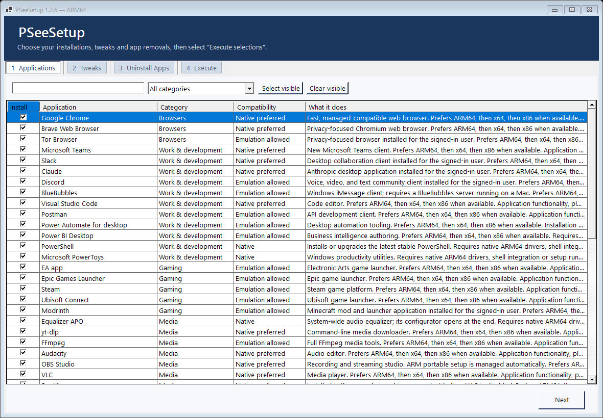
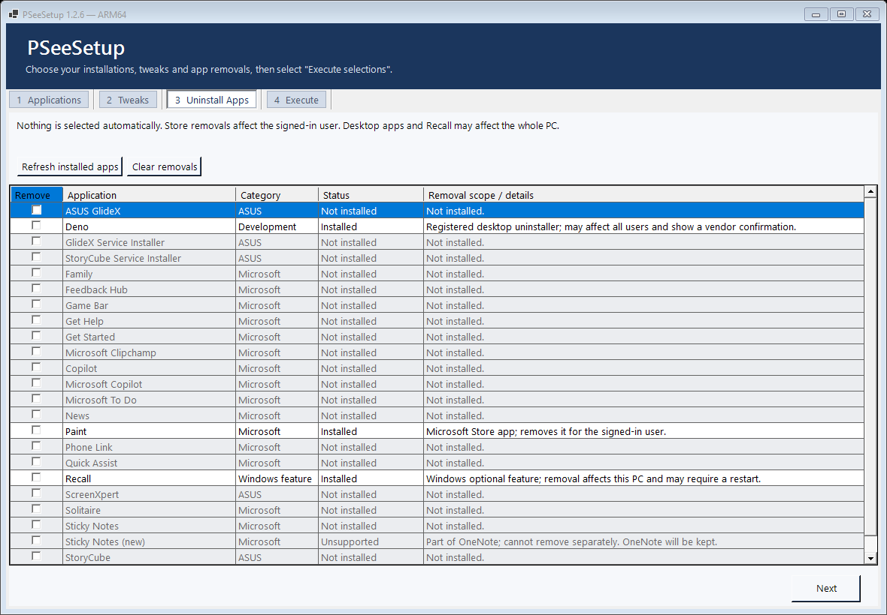

# PSeeSetup

A Windows 11 setup utility for **x64 and ARM64**, including Qualcomm Snapdragon laptops. Install selected applications, apply Windows preferences, and remove unwanted apps through a four-tab interface.

**Status: 1.2.6 prerelease.** This is a personal setup tool being opened for community testing, not a certification that every listed application's features work on every PC.

> **Read before running:** setup requires all mounted internal fixed drives to be fully decrypted. It permanently disables UAC, may temporarily enable it for per-user installations, applies the preferences you select, and can restart Windows automatically up to five times. These requirements still apply if you select only app removals. Run only if you want those changes. Back up important data first.

## Download and run

Download **PSeeSetup-1.2.6.zip** from [Releases](https://github.com/jo3see/PSeeSetup/releases). Extract the entire folder, then launch the top-level **PSeeSetup.exe**. It selects the native x64 or ARM64 application. The download is self-contained; a preinstalled .NET runtime is not required.

The Windows executables are not code-signed. The encryption prerequisite has its own confirmation before any decryption begins. Setup requires the signed-in administrator identity and resumes after required restarts.

## Four tabs

1. **Applications** — select software to install, with search and categories. Existing applications are generally skipped; PowerShell retains its upgrade rule.
2. **Tweaks** — select Windows preferences, optional Windows features and the optional Razer download-domain block.
3. **Uninstall Apps** — 24 requested entries, all unchecked by default. Absent, protected or undetected entries are greyed out. Refresh repeats detection. Store removals affect only the signed-in user; desktop uninstallers and Recall may affect the entire PC. Publisher names do not block selected removals.
4. **Execute** — review your selections across the tabs, then start the live run. Progress is logged. **Open log**, beside Exit, opens the current run's exact log file.

Installation and tweak defaults are already selected. Review those tabs even when your main goal is removing unwanted apps. There is no simulation mode, presets interface or separate Review page.





Screenshots use synthetic installed-app data from UI tests.

## Architecture behavior

- On ARM64, ordinary apps prefer ARM64, then x64, then x86 installers when available.
- On x64, installers are selected from x64 and x86; ARM64 packages are not selected.
- Drivers, shell integrations and specific setup dependencies require native ARM64 support. Intel kernel drivers cannot be emulated.
- Installer architecture and compatibility policy are recorded separately. **"Native preferred" is a policy, not proof that an existing installation is ARM64.** Presence verification is not a functional or battery-life test.
- HTTPS downloads, pinned hashes where specified, executable payload checks and publisher checks remain enforced for application installation. Selected removals use exact installed identities and registered uninstallers without a publisher/signature allowlist. Protected/shared packages remain blocked; no broad file or service deletion is used.

## Known limitations

- **Unraid USB Creator:** held when Raspberry Pi Imager is detected because the current vendor installer can conflict with or uninstall Pi Imager.
- **TeamViewer:** ARM64 uses a signed, architecture-checked vendor MSI. Existing x64 installations are preserved. A fresh native ARM64 installation still needs a live integration test.
- **Sticky Notes (new):** part of OneNote; independent removal is not supported. OneNote is retained.
- **Wireshark:** live capture requires separately installed ARM64 Npcap. Parsec on ARM omits bundled virtual drivers. Hardware-specific and shell features need their own functional tests.
- **Windows edition:** unavailable features such as Hyper-V, Windows Sandbox or Client for NFS are skipped.
- Store app removals do not remove registrations for other users or future-user provisioning. Some registered desktop uninstallers can show vendor confirmation dialogs.
- Runtime logs and saved state use `%ProgramData%\PCSetup\Runs` for continuity with earlier internal builds. Start a fresh run after changing versions. Failed-install JSON imports create a fresh applications-only selection and strip app removals, tweaks and Windows-feature selections.

## Validation so far

- **90/90 automated checks passed in a native ARM64 process.**
- **90/90 passed in an x64 process under Windows ARM emulation.** This does not establish testing on physical Intel/AMD hardware.
- Live testing on an ASUS Snapdragon laptop confirmed selected app removals and setup/resume behavior. Most application installers were skipped because those apps already existed. Not all installer paths, drivers, peripherals or app features have been exercised.
- No battery-consumption or gaming-performance certification is implied.

Sanitized automated results are in [docs/testing](docs/testing). Personal run logs, state files, installer caches and old experimental builds are excluded from this repository.

## Build

Requires Windows and the **.NET 10 SDK**. No SDK or downloaded vendor installer is committed.

```powershell
.\build.ps1
```

This publishes the x64 app, ARM64 app and automatic launcher into `outputs\PSeeSetup 1.2.6`. The script uses a local SDK if available, otherwise `dotnet.exe` on PATH.

To run the automated checks on an ARM64 PC:

```powershell
dotnet publish tests\PCSetup.Tests\PCSetup.Tests.csproj -c Release -r win-arm64 --self-contained true -o work\tests-arm64
.\work\tests-arm64\PCSetup.Tests.exe
```

On an x64 PC, substitute `win-x64` and `work\tests-x64`. The tests use synthetic status data, mock removal/installer execution and off-screen UI rendering; they do not execute live setup. Optional vendor-download checks are opt-in.

## Project history and license

[CHANGELOG.md](CHANGELOG.md) summarizes development through the first public prerelease. Earlier experimental binaries remain private backups. The historical [ARM research](ARM-RESEARCH.md) provides background; the current README and release notes take precedence where behavior changed.

MIT licensed. Third-party applications retain their own licenses; this project does not grant rights to those products.
